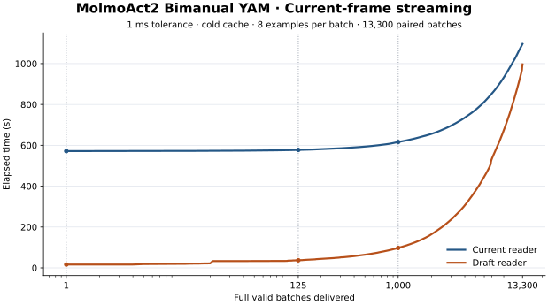

# Does LeRobot #5388 start training faster?

Quentin's draft avoids the cold MP4 indexing wait. On the reported MolmoAct2 bucket it constructed the reader in 6.93 seconds and yielded its first current-frame sample at 15.13 seconds. With the 100-step action targets used for training, it delivered zero batches on MolmoAct2, ABC-130K and DROID. Pepijn's cold baseline delivered 1,000 batches in 653.7 seconds on MolmoAct2, 2,598.0 seconds on ABC-130K and 325.5 seconds on DROID.

This interim report contains finished CPU runs and local correctness checks. The fresh publisher-index comparison and ABC camera-history runs are scheduled in the ongoing benchmark. The Molmo current-frame comparison below has completed on both cold and warm disks. The reviewed draft opened November 16, 2026 at 19:06 UTC and GitHub shows its last update at 19:09 UTC the same day. The pinned head is `1a60cb4b`. [LeRobot #5388](https://github.com/huggingface/lerobot/pull/5388) · [Prerequisite Datasets #8983](https://github.com/huggingface/datasets/pull/8983)

A usable batch here has eight distinct new `(episode, frame)` anchors, the expected tensor shapes and dtypes for the three cameras, state and 100 actions, and the expected camera padding values. Each distinct anchor counts once, including anchors near episode ends where future actions require padding. We checked actual pixels, action and state values and all padding against an independent FFmpeg-backed reader on the finite fixture. The cloud checks cover the observed prefix. A whole training epoch was not run on these sources.

Both readers ran back-to-back on one 16-vCPU HF Jobs CPU XL host, with a 32-episode pool, batch size 8 and no DataLoader subprocesses. Timings start before the constructor. The direct reader ran as fast as the CPU consumer could take batches. The normal trainer and multi-worker resume were exercised separately on the fixture. For each rate, the timing from batch 125 includes two verified pool refills and at least 125 further batches. Those refills can happen well after batch 1,000. [Methods, versions and source inventory](method.md)

### MolmoAct2

| Reader and starting state | Constructor (s) | Batch 1 (s) | Batch 125 (s) | Batch 1,000 (s) | Windows/s across refills | Episodes/batch, first 1k / across refills | Peak RAM (GB) | Finite pass (days, est.) |
|---|---:|---:|---:|---:|---:|---:|---:|---:|
| Pepijn, As published, fresh | 568.1 | 611.6 | 617.3 | 653.7 | 195.0 | 6.95 / 5.94 | 15.93 | 4.52 |
| Quentin, As published, fresh | 7.5 | — | — | — | — | — / — | 1.09 | — |

The cold baseline delivered 234,304 distinct windows with 0 duplicates and 2 verified pool refills. At batch 1,000, the largest single-episode share averaged 22.8% of a batch. 0.007% of within-batch pairs were from the same episode and at most 0.2 seconds apart.

The draft raised `TypeError: expected Tensor as element 0 in argument 0, but got dict`.

### ABC-130K

| Reader and starting state | Constructor (s) | Batch 1 (s) | Batch 125 (s) | Batch 1,000 (s) | Windows/s across refills | Episodes/batch, first 1k / across refills | Peak RAM (GB) | Finite pass (days, est.) |
|---|---:|---:|---:|---:|---:|---:|---:|---:|
| Pepijn, As published, fresh | 2,505.2 | 2,583.9 | 2,586.4 | 2,598.0 | 557.3 | 6.98 / 5.87 | 24.30 | 7.97 |
| Quentin, As published, fresh | 10.1 | — | — | — | — | — / — | 5.36 | — |

The cold baseline delivered 289,544 distinct windows with 0 duplicates and 2 verified pool refills. At batch 1,000, the largest single-episode share averaged 22.4% of a batch. 0.018% of within-batch pairs were from the same episode and at most 0.2 seconds apart.

The draft raised `TypeError: expected Tensor as element 0 in argument 0, but got dict`.

### DROID

| Reader and starting state | Constructor (s) | Batch 1 (s) | Batch 125 (s) | Batch 1,000 (s) | Windows/s across refills | Episodes/batch, first 1k / across refills | Peak RAM (GB) | Finite pass (days, est.) |
|---|---:|---:|---:|---:|---:|---:|---:|---:|
| Pepijn, As published, fresh | 195.1 | 296.0 | 302.4 | 325.5 | 269.1 | 6.41 / 5.46 | 5.82 | 1.19 |
| Quentin, As published, fresh | 6.4 | — | — | — | — | — / — | 4.56 | — |

The cold baseline delivered 31,592 distinct windows with 0 duplicates and 2 verified pool refills. At batch 1,000, the largest single-episode share averaged 27.7% of a batch. 0.125% of within-batch pairs were from the same episode and at most 0.2 seconds apart.

The draft raised `ValueError: too many dimensions 'str'`.

### Molmo current-frame control

With the draft at its native 0.1 ms tolerance, the first current-frame sample arrived at 15.13 seconds. A subsequent frame fetch raised `FrameTimestampError`, so the consumer received zero complete batches. Casting an absolute timestamp late in a shared MP4 to float32 moves the query by more than 0.1 ms. Both pinned readers passed all 786 fixture anchors at 1 ms, including pixels. This permits a separate matched test on real Molmo with three current images, state and the current action. Its timings apply to that workload. [Precision checks](correctness/README.md#packed-video-timestamp-precision)

At the same native tolerance, a new baseline process with a local index reached its first sample at 33.80 seconds, first batch at 43.01 seconds, and batch 1,000 at 79.64 seconds. It delivered 234,304 distinct anchors and averaged 207.7 windows/s across two refills. That warm baseline and the fresh draft answer different cache questions.

On the same fresh host at **1 ms**, the draft delivered 1,000 batches in **97.67 s**, versus **616.15 s** for the baseline. The first thousand batches averaged 7.05 and 6.95 episodes per batch respectively. The two distributions overlapped by 94.4% when matched on episode count, largest episode share and near-frame pairs. Within that overlap, the average consumer wait was 86.2 ms for the draft and 92.2 ms for the baseline, including the first batch wait. Initial construction was 7.2 and 524.0 seconds.

Over the longer run, the draft delivered 109.9 unique windows/s across two refills, versus 213.6 for the baseline. Average episode diversity in those longer timing windows was 7.06 and 5.94 respectively. The baseline was still **99.94 s behind** at batch 13,300, the last point observed by both readers. Neither curve crossed in this pair. These elapsed times include construction and the actual sampling order each reader chose. [Matched-prefix data](measurements/cold-current-frame.json)

On a **warm restart**, the first batch again reached the consumer sooner with the draft (10.31 vs 39.78 s). The baseline overtook at **batch 514** (4,112 examples), held the lead through batch 1,000, and finished there at **75.21 vs 91.14 s**. The overlap in first-1,000 episode diversity was again 94.4%. The corresponding diversity-matched average waits were 73.4 ms for the baseline and 83.3 ms for the draft. This repeat ended at 1,000 batches, before either reader's second refill. [Warm time-to-count trace](measurements/warm-current-frame.json) · [Warm delivery curve](measurements/warm-current-frame.svg)

### What a publisher-built index changes

The index can be built once for a dataset revision and reused across consumers. It maps a video timestamp to the corresponding bytes in an MP4. Pepijn's reader validates the matching archive, then memory-maps it read-only. The operating system brings pages into memory as the reader uses them. An archive of several gigabytes does not require a private copy of that size in each worker's RAM. Peak process memory here includes the reader, decoded buffers, episode metadata and the portions of the archive it touched. [Pinned index resolver](https://github.com/huggingface/lerobot/blob/fe1c54594f6ba275fccf210b9f7b11f0e2324b89/src/lerobot/datasets/streaming_sidecar.py#L217-L234) · [Mapped archive implementation](https://github.com/huggingface/lerobot/blob/fe1c54594f6ba275fccf210b9f7b11f0e2324b89/src/lerobot/streaming/manifest.py#L447-L466)

Molmo lists three older index objects. The two full names point to identical content. The archives use schema 1 and lack the source fingerprints the pinned reader needs. The loader built a schema-3 archive on its first run. In the simulated publication measurements, a fresh process receives a matching archive from private storage. The consumer time includes download and checksum verification before construction. A warm restart instead uses the index and metadata already on the same disk.

GR00T 2 made a different part of training reusable. Its published sample starts say which training windows are eligible. A video seek index says where the bytes live. Sample order and prefetch are runtime choices. Publishing one index does not settle the others. NVIDIA's three-view preparation test and 1,024-GPU overlap experiment motivate measuring CPU decode work separately from consumer wait. The CPU times here do not predict a training cluster's exposed wait. [GR00T 2, §4.7.2 and appendix K.4.3](https://research.nvidia.com/labs/gear/gr00t-2/assets/gr00t2_whitepaper.pdf#page=131)

| Dataset | Native cold build (s) | Index on disk (GB) | Private receipt and verification (s) | Index header reads (MB / MP4s) | Training video reads (MB / MP4s) | Parquet reads (MB) |
|---|---:|---:|---:|---:|---:|---:|
| MolmoAct2 | 534.2 | 1.834 | — | 3,119.0 / 5,860 | 3,261.4 / 120 | 46.4 |
| ABC-130K | 2,372.0 | 8.563 | — | 20,020.0 / 38,164 | 1,175.3 / 120 | 230.2 |
| DROID | 181.7 | 0.630 | — | 513.7 / 784 | 196.9 / 135 | 4,867.7 |

Index header, Parquet and training video bytes above are instrumented HTTP payloads for the cold baseline through batch 1,000, including prefetch. The same MP4 can appear in both the index and training columns. Other Hub/Xet transfers can bypass the HTTP hooks. The resource export records process-namespace receive bytes as a separate measure of total traffic.

### Consumer stalls and worker time

The wait percentiles cover the first 1,000 batches of each cold baseline cell. Each stage column sums elapsed time over concurrent calls up to that milestone. Decode includes waiting for the underlying cache. Calls can overlap each other and consumer work, so the columns cannot be added into an elapsed preparation time or a decode percentage. [Resource measurements](measurements/resources.csv.gz)

| Dataset | Wait p50 / p95 / p99 (ms) | Native video range calls (s, summed) | RGB decode calls (s, summed) | Parquet range calls (s, summed) |
|---|---:|---:|---:|---:|
| MolmoAct2 | 40.9 / 53.0 / 64.6 | 406.4 | 121.2 | 81.0 |
| ABC-130K | 12.9 / 15.1 / 30.4 | 284.9 | 36.3 | 123.2 |
| DROID | 20.8 / 78.6 / 150.7 | 53.7 | 43.8 | 266.2 |

## What changed in the training path

The proposed reader reads groups of episodes from Parquet, shuffles their rows, and decodes the requested video through a shared byte-range cache. This removes the up-front scan of MP4 headers. The same diff also removes sampling, worker partitioning and checkpoint logic that landed after #3917. A reader can therefore initialize faster while delivering different training data. [Pinned draft](https://github.com/huggingface/lerobot/blob/1a60cb4b800c2947834342752c32f064c8bf143c/src/lerobot/datasets/streaming_dataset.py) · [Changes from the baseline](https://github.com/huggingface/lerobot/pull/5388/files)

| Check | Pepijn's baseline | Quentin's draft |
|---|---|---|
| `lerobot-train`, CPU ACT, one or two ranks, one or four workers | Each topology completed 8 optimizer steps. | The dataset factory passed `max_num_shards`. The constructor rejected it before the DataLoader started. |
| Three cameras, state, 100 actions, uneven ends and shared MP4 offsets | All 786 anchors appeared once with one and four workers. Every state, action, padding mask and decoded pixel matched the independent fixture. | An action window that includes the current step passed a row dictionary to `torch.stack`. A window with only positive offsets failed on a missing `action_is_pad`. |
| Camera history and offsets | Frames and padding matched the reference. | The history-only fixture delivered 112 anchors, then read the exclusive end of a video. Each offset camera had 112 wrong padding masks and 12 wrong frame windows before the exception. |
| Episode selection, ordering and ranks | A six-episode selection returned all 374 requested anchors. Two finite ranks covered 396 and 390 disjoint anchors. | With temporal requests disabled, selection returned all 786 anchors. Two direct reader ranks each returned all 786. Seeds 42 and 43 produced the same order. The trainer failed before distributed dispatch could be tested. |
| Resume with prefetch | After checkpoint 3, all five following batches exactly matched each topology's own uninterrupted run. | The reader had no save/load state API. The trainer failed before making a checkpoint. |

The baseline's repeating multi-worker mode has a narrower coverage guarantee than finite iteration. On an 86-frame fixture, four workers delivered 79 distinct anchors in the first 86 training samples. Each worker restarts when it finishes its shard. This matters when defining an epoch or estimating one finite pass. [Reproduction and traces](correctness/README.md) · [Upstream documentation clarification #5417](https://github.com/huggingface/lerobot/pull/5417)

## Merge implications

Keep construction time and time to an optimizer-ready batch as separate metrics in the PR. To compare the block cache on 100-step training, first make the normal factory path work, preserve nonnumeric Parquet columns, and pass the independent oracle for action and camera windows on shared media. Restore episode selection and demonstrate finite sample coverage, effective seeding, rank partitioning and same-topology checkpoint resume through the trainer. A cold or prepared index cannot compensate for a batch that the competing reader never delivers.

The per-cell CSV includes milestones, error reasons, diversity, sustained rates and projections. The separate identity audit checks recorded frame IDs against every episode's independently read length. Rows marked partial stop at their last observed batch. [Comparison CSV](measurements/comparison.csv) · [Coverage CSV](measurements/coverage.csv) · [Benchmark and reproduction](method.md)
