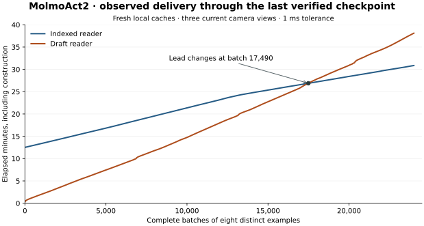

# Does LeRobot #5388 start training faster?

**The fast constructor reproduces. The 100-step training workload fails before batch one.** On Quentin's exact MolmoAct2 bucket, the draft constructed its reader in **6.93 seconds** and yielded the first current-frame sample at **15.13 seconds**. A timestamp error then prevented the consumer from receiving a complete batch at the default tolerance. With three current cameras and 100 target actions, the draft delivered zero batches on MolmoAct2, ABC-130K and DROID. The normal `lerobot-train` path failed in the dataset factory on the small fixture.

When both readers delivered the same current-frame workload at 1 ms, Quentin won the first 1,000 batches on fresh disks. With a matching publisher-built index, Pepijn took the lead at **batch 702**. With local caches already populated, he took the lead at **batch 514**. With a full cold index build, one longer run crossed near **batch 17,490**. These are observations at batch size eight on the tested CPU hosts.

The reviewed draft opened **November 16, 2026 at 19:06 UTC** and GitHub shows its last update at **19:09 UTC** that day. As checked November 19, the draft was still blocked, with review required. Baseline `fe1c5459`, proposal `1a60cb4b` and Datasets `464fe790` are pinned throughout. [LeRobot #5388](https://github.com/huggingface/lerobot/pull/5388) · [Datasets #8983](https://github.com/huggingface/datasets/pull/8983)

## Three-camera training with a 100-step action target

For the primary workload, a usable batch has eight distinct new `(episode, frame)` anchors, the expected tensor shapes and dtypes for the three cameras, state and 100 actions, and the expected camera padding values. Each distinct anchor counts once, including anchors near episode ends where future actions require padding. We checked actual pixels, action and state values and all padding against an independent FFmpeg-backed reader on the finite fixture. The independent episode-length check also verified the cloud anchor bounds. The large-corpus measurements cover prefixes of a finite pass.

Each timed pair ran back-to-back on the same 16-vCPU HF Jobs CPU XL host, with a 32-episode pool, batch size 8 and no DataLoader subprocesses. Timings start before the constructor. The direct reader ran as fast as the CPU consumer could take batches. The normal trainer and multi-worker resume were exercised separately on the fixture. For each rate, the timing from batch 125 includes two verified pool refills and at least 125 further batches. Those refills can happen well after batch 1,000. [Methods, versions and source inventory](method.md)

Times in the tables are seconds from the start of the consumer. Ranges span repeated runs of the same configuration. A dash means that a milestone or a qualified rate was unavailable. Peak RAM is decimal GB of process-tree resident memory across the full observed cell. Each finite-pass projection uses rates from batch 125 through two refills. An 8,000-anchor prefix checks identities and tensor structure, and each full-pass estimate assumes the longer measured rate continues across the rest of the source.

The primary pairs used the same pinned Datasets dependency. A DROID baseline control on released Datasets 5.2.0 delivered two valid batches, with its first at 90.08 seconds under warm caches. That short compatibility check is listed separately in the CSV.

The cold action-window runs directly covered 0.076% of ABC, 0.114% of DROID, and 0.308% of Molmo. The finite-pass estimates are conditional on the observed transfer, decode and sampling rates holding over the rest of each snapshot.

### MolmoAct2

| Reader and starting state | Constructor (s) | Batch 1 (s) | Batch 125 (s) | Batch 1,000 (s) | Windows/s across refills | Episodes/batch, first 1k / across refills | Peak RAM (GB) | Finite pass (days, est.) |
|---|---:|---:|---:|---:|---:|---:|---:|---:|
| Pepijn, As published, fresh | 568.1 | 611.6 | 617.3 | 653.7 | 195.0 | 6.95 / 5.94 | 15.93 | 4.52 |
| Quentin, As published, fresh | 7.5 | — | — | — | — | — / — | 1.09 | — |
| Pepijn, Private index, fresh | 37.4 | 97.1 | 102.8 | 141.5 | — | 6.95 / — | 15.18 | — |
| Quentin, Fresh, paired with index recipient | 7.3 | — | — | — | — | — / — | 1.13 | — |
| Pepijn, Warm restart (2 runs) | 2.0–3.1 | 40.5–41.1 | 45.1–46.0 | 76.6–77.1 | 214.8–220.0 | 6.95 / 5.94 | 15.56–15.58 | 4.00–4.10 |
| Quentin, Warm restart (2 runs) | 1.5–1.6 | — | — | — | — | — / — | 0.83–0.84 | — |

The cold baseline delivered 234,304 distinct windows with 0 duplicates and 2 verified pool refills. At batch 1,000, the largest single-episode share averaged 22.8% of a batch. 0.007% of within-batch pairs were from the same episode and at most 0.2 seconds apart.

The draft raised `TypeError: expected Tensor as element 0 in argument 0, but got dict`.

### ABC-130K

| Reader and starting state | Constructor (s) | Batch 1 (s) | Batch 125 (s) | Batch 1,000 (s) | Windows/s across refills | Episodes/batch, first 1k / across refills | Peak RAM (GB) | Finite pass (days, est.) |
|---|---:|---:|---:|---:|---:|---:|---:|---:|
| Pepijn, As published, fresh | 2,505.2 | 2,583.9 | 2,586.4 | 2,598.0 | 557.3 | 6.98 / 5.87 | 24.30 | 7.97 |
| Quentin, As published, fresh | 10.1 | — | — | — | — | — / — | 5.36 | — |
| Pepijn, Private index, fresh | 149.0 | 261.1 | 263.9 | 278.5 | 520.4 | 6.98 / 5.87 | 24.11 | 8.51 |
| Quentin, Fresh, paired with index recipient | 8.9 | — | — | — | — | — / — | 4.85 | — |
| Pepijn, Warm restart (2 runs) | 8.0–11.6 | 88.3–127.6 | 91.0–131.6 | 102.5–149.2 | 379.6–570.4 | 6.98 / 5.87 | 23.96–24.03 | 7.76–11.66 |
| Quentin, Warm restart (2 runs) | 1.7–1.8 | — | — | — | — | — / — | 4.63–5.27 | — |
| Pepijn, History, warm | 8.0 | 89.0 | 95.1 | 135.9 | — | 6.98 / — | 22.66 | — |
| Quentin, History, warm | 0.9 | — | — | — | — | — / — | 4.69 | — |
| Pepijn, History, private index | 154.9 | 267.8 | 276.0 | 326.7 | 144.3 | 6.98 / 5.87 | 24.09 | 30.68 |

Requesting 0.8 seconds of history means five images per camera, or 15 images per example. The prepared baseline delivered 144.3 distinct windows/s across two refills on the history repeat, versus 520.4 windows/s for one image per camera in the original prepared run. Both averaged 5.87 episodes per batch over the long interval. At the measured history rate a finite ABC pass would take about 30.7 days. These prepared runs used separate CPU XL hosts. The native warm history run stopped after 177,256 anchors at its time cap, before its first verified refill.

The cold baseline delivered 289,544 distinct windows with 0 duplicates and 2 verified pool refills. At batch 1,000, the largest single-episode share averaged 22.4% of a batch. 0.018% of within-batch pairs were from the same episode and at most 0.2 seconds apart.

The draft raised `TypeError: expected Tensor as element 0 in argument 0, but got dict`.

### DROID

| Reader and starting state | Constructor (s) | Batch 1 (s) | Batch 125 (s) | Batch 1,000 (s) | Windows/s across refills | Episodes/batch, first 1k / across refills | Peak RAM (GB) | Finite pass (days, est.) |
|---|---:|---:|---:|---:|---:|---:|---:|---:|
| Pepijn, As published, fresh | 195.1 | 296.0 | 302.4 | 325.5 | 269.1 | 6.41 / 5.46 | 5.82 | 1.19 |
| Quentin, As published, fresh | 6.4 | — | — | — | — | — / — | 4.56 | — |
| Pepijn, Private index, fresh | 12.1 | 126.2 | 135.1 | 162.2 | 215.1 | 6.41 / 5.46 | 5.64 | 1.49 |
| Quentin, Fresh, paired with index recipient | 6.3 | — | — | — | — | — / — | 5.02 | — |
| Pepijn, Warm restart (2 runs) | 2.0–2.5 | 90.5–99.6 | 95.7–105.6 | 115.0–125.0 | 298.1–328.6 | 6.41 / 5.46 | 5.02–5.47 | 0.97–1.07 |
| Quentin, Warm restart (2 runs) | 0.7 | — | — | — | — | — / — | 4.21–4.25 | — |

The cold baseline delivered 31,592 distinct windows with 0 duplicates and 2 verified pool refills. At batch 1,000, the largest single-episode share averaged 27.7% of a batch. 0.125% of within-batch pairs were from the same episode and at most 0.2 seconds apart.

The draft raised `ValueError: too many dimensions 'str'`.

### Molmo current-frame comparison

At the draft's native 0.1 ms tolerance, its constructor took 6.93 s and its first current-frame sample arrived at 15.13 s. A following fetch raised `FrameTimestampError` before the first complete batch. Casting the absolute timestamp of a frame late in a shared MP4 to float32 can move it by more than 0.1 ms. Both pinned readers passed all 786 fixture anchors at 1 ms, including pixels. A native 0.1 ms baseline process with the index already local delivered its first batch at 43.01 s and batch 1,000 at 79.64 s. [Precision checks](correctness/README.md#packed-video-timestamp-precision)

The following pairs used identical **1 ms tolerance, three current camera images, current state and current action**. The starting state refers to the consumer's local disk. Times include construction and, in the published-index simulation, verified index receipt. All arms delivered 8,000 distinct in-bounds examples through batch 1,000. Episode diversity there averaged 6.95 for the baseline and 7.05 for the draft. The two distributions overlapped by 94.4% after grouping batches by episode count, largest episode share and near-frame pairs.

| Starting state | Pepijn to batch 1,000 | Quentin to batch 1,000 | Observed lead change | Last compared batch |
|---|---:|---:|---|---:|
| Fresh, draft ran first | 616.15 s | 97.67 s | Draft led throughout | 13,300 |
| Fresh, baseline ran first | 802.22 s | 118.65 s | Baseline took the lead near 17,490 | 24,000 |
| Fresh, simulated publisher index | 199.72 s | 224.34 s | Baseline took the lead at 702 | 1,000 |
| Warm restart | 75.21 s | 91.14 s | Baseline took the lead at 514 | 1,000 |

Construction explains much of the early cold gap. In the first pair it took 524.05 s for the baseline and 7.23 s for the draft. Across two refills each, their longer windows yielded 213.6 and 109.9 distinct examples/s. Sampling diversity over those windows differed, averaging 5.94 and 7.06 episodes per batch. To compare a common segment, we looked at batches 126 through 13,300. The same count of 105,400 additional examples took 519.06 s for the baseline and 959.16 s for the draft. Within the 84.1% overlap in episode mix, average consumer waits were **39.2 ms** and **67.9 ms** respectively. [Matched waits and per-group counts](measurements/cold-matched-after125.json) · [First cold delivery curve](measurements/cold-current-frame.svg)

The second cold pair reached the crossover after about 26.9 minutes and 139,920 examples. The baseline held the lead for the remaining 6,511 observed batches, reaching batch 24,000 at **30 min 52 s**, versus **38 min 7 s** for the draft. The draft hit its deadline before batch 25,000. The ID audit includes 24,592 complete batches in its partial raw trace. For the crossover we retained the last 24,000 confirmed in both the trace and the saved checkpoint. The in-job final bucket inventory was skipped. An independent inventory taken 24.3 seconds after the job ended matched the pre-run digest. The CSV preserves the native source-check flag and the checkpoint audit records the independent verification. [Audit and evidence hashes](measurements/molmo-tol02-checkpoint-crossover.json) · [Post-run inventory](measurements/molmo-tol02-external-post-manifest.json)

The published-index simulation includes 10.38 s to receive and checksum the archive. The baseline's first batch took 138.61 s and the draft's took 34.66 s. The warm pair's first batches took 39.78 and 10.31 s. Both controls stopped at batch 1,000. Their crossovers are measured milestones on those hosts, and the fresh draft's 1,000-batch time varied from 97.67 to 224.34 s across jobs. [Published-index control](measurements/prepared-current-frame.json) · [Warm control](measurements/warm-current-frame.json)

### What a publisher-built index changes

The index can be built once for a dataset revision and reused across consumers. It maps a video timestamp to the corresponding bytes in an MP4. Pepijn's reader validates the matching archive, prepares a local file for random access, and memory-maps that file read-only. The operating system brings pages into memory as the reader uses them. An archive of several gigabytes does not require a private copy of that size in each worker's RAM. Peak process memory here includes the reader, decoded buffers, episode metadata and the portions of the archive it touched. [Pinned index resolver](https://github.com/huggingface/lerobot/blob/fe1c54594f6ba275fccf210b9f7b11f0e2324b89/src/lerobot/datasets/streaming_sidecar.py#L217-L234) · [Mapped archive implementation](https://github.com/huggingface/lerobot/blob/fe1c54594f6ba275fccf210b9f7b11f0e2324b89/src/lerobot/streaming/manifest.py#L447-L466)

Molmo lists three older index objects. The two full names point to identical content. The archives use schema 1 and lack the source fingerprints the pinned reader needs. The loader built a schema-3 archive on its first run. In the simulated publication measurements, a fresh process receives a matching archive from private storage. The consumer time includes download and checksum verification before construction. A warm restart instead uses the index and metadata already on the same disk.

GR00T 2 made a different part of training reusable. Its published sample starts say which training windows are eligible. A video seek index says where the bytes live. Sample order and prefetch are runtime choices. Publishing one index does not settle the others. NVIDIA's three-view preparation test and 1,024-GPU overlap experiment motivate measuring CPU decode work separately from consumer wait. The CPU times here do not predict a training cluster's exposed wait. [GR00T 2, §4.7.2 and appendix K.4.3](https://research.nvidia.com/labs/gear/gr00t-2/assets/gr00t2_whitepaper.pdf#page=131)

With a matching published index simulated, 1,000 complete three-view action batches took **141.5 seconds on Molmo, 278.5 seconds on ABC, and 162.2 seconds on DROID**. The same fresh-consumer observations with the sources as actually published were 653.7, 2,598.0 and 325.5 seconds. For ABC, transfer and checksum cost 14.0 seconds. The constructor then took another 149.0 seconds, including its normal work to open metadata and prepare the local index. A later local restart avoids much of that cost. The prepared Molmo baseline reached its time cap after 216,816 distinct anchors and one verified refill, so its table leaves the sustained rate and full-pass estimate open. The draft never delivered a 100-step batch in either fresh condition, so these measurements quantify the value of publication for the baseline.

| Dataset | Native cold build (s) | Index on disk (GB) | Private receipt and verification (s) | Index header reads (MB / MP4s) | Training video reads (MB / MP4s) | Parquet reads (MB) |
|---|---:|---:|---:|---:|---:|---:|
| MolmoAct2 | 534.2 | 1.834 | 9.0 | 3,119.0 / 5,860 | 3,261.4 / 120 | 46.4 |
| ABC-130K | 2,372.0 | 8.563 | 14.0 | 20,020.0 / 38,164 | 1,175.3 / 120 | 230.2 |
| DROID | 181.7 | 0.630 | 4.3 | 513.7 / 784 | 196.9 / 135 | 4,867.7 |

Index header, Parquet and training video bytes above are instrumented HTTP payloads for the cold baseline through batch 1,000, including prefetch. The same MP4 can appear in both the index and training columns. Other Hub/Xet transfers can bypass the HTTP hooks. The resource export records process-namespace receive bytes as a separate measure of total traffic.

### Consumer stalls and worker time

The wait percentiles cover the first 1,000 batches of each cold baseline cell. Each stage column sums elapsed time over concurrent calls up to that milestone. Decode includes waiting for the underlying cache. Calls can overlap each other and consumer work, so the columns cannot be added into an elapsed preparation time or a decode percentage. [Resource measurements](measurements/resources.csv.gz)

| Dataset | Wait p50 / p95 / p99 (ms) | Native video range calls (s, summed) | RGB decode calls (s, summed) | Parquet range calls (s, summed) |
|---|---:|---:|---:|---:|
| MolmoAct2 | 40.9 / 53.0 / 64.6 | 406.4 | 121.2 | 81.0 |
| ABC-130K | 12.9 / 15.1 / 30.4 | 284.9 | 36.3 | 123.2 |
| DROID | 20.8 / 78.6 / 150.7 | 53.7 | 43.8 | 266.2 |

### How much RAM did the published index use?

For each dataset, we ran fresh one-worker and four-worker baseline processes against the same validated disk index on one CPU XL host. Both settings consumed 125 batches of eight, with the trainer’s per-worker episode pool, fetch concurrency, and four-batch prefetch. Each table entry is a sampled peak. Linux proportional set size (PSS) apportions a shared page among processes, so summing PSS across the loader counts that page roughly once. Summed RSS counts it once per mapping.

| Dataset | Workers | Archive / local map (GB) | Index PSS (GB) | Whole loader PSS (GB) | Summed RSS (GB) |
|---|---:|---:|---:|---:|---:|
| ABC-130K | 1 | 8.56 / 17.49 | 17.45 | 20.91 | 21.11 |
| ABC-130K | 4 | 8.56 / 17.49 | 17.45 | 24.49 | 72.30 |
| MolmoAct2 | 1 | 1.83 / 3.48 | 3.48 | 8.30 | 8.48 |
| MolmoAct2 | 4 | 1.83 / 3.48 | 3.48 | 13.64 | 24.24 |
| DROID | 1 | 0.63 / 1.33 | 1.33 | 3.82 | 4.01 |
| DROID | 4 | 0.63 / 1.33 | 1.33 | 8.37 | 13.18 |

The ABC archive and derived map together occupied 26.05 GB on disk. Preparing that map took 143.77 s in this separate run. The namespace received 6.52 GB during the transfer of the 8.56 GB logical archive. This counter includes protocol overhead and other traffic in the namespace. The index fit under this CPU XL host’s 134.0 GB memory limit (124.8 GiB) and accounted for most of the one-worker PSS. Four workers shared its resident pages. On each host the one-worker run preceded the four-worker run, so metadata and OS page caches could be warmer on the second run. For Molmo the earlier timed consumer had already prepared the map and loaded the metadata. [Worker, receipt and memory measurements](measurements/worker-memory.csv)

## What changed in the training path

The proposed reader reads groups of episodes from Parquet, shuffles their rows, and decodes the requested video through a shared byte-range cache. This removes the up-front scan of MP4 headers. The same diff also removes sampling, worker partitioning and checkpoint logic that landed after #3917. A reader can therefore initialize faster while delivering different training data. [Pinned draft](https://github.com/huggingface/lerobot/blob/1a60cb4b800c2947834342752c32f064c8bf143c/src/lerobot/datasets/streaming_dataset.py) · [Changes from the baseline](https://github.com/huggingface/lerobot/pull/5388/files)

| Check | Pepijn's baseline | Quentin's draft |
|---|---|---|
| `lerobot-train`, CPU ACT, one or two ranks, one or four workers | Each topology completed 8 optimizer steps. | The dataset factory passed `max_num_shards`. The constructor rejected it before the DataLoader started. |
| Three cameras, state, 100 actions, uneven ends and shared MP4 offsets | All 786 anchors appeared once with one and four workers. Every state, action, padding mask and decoded pixel matched the independent fixture. | An action window that includes the current step passed a row dictionary to `torch.stack`. A window with only positive offsets failed on a missing `action_is_pad`. |
| Camera history and offsets | Frames and padding matched the reference. | The history-only fixture delivered 112 anchors, then read the exclusive end of a video. Each offset camera had 112 wrong padding masks and 12 wrong frame windows before the exception. |
| Episode selection, ordering and ranks | A six-episode selection returned all 374 requested anchors. Two finite ranks covered 396 and 390 disjoint anchors. | With temporal requests disabled, selection returned all 786 anchors. Two direct reader ranks each returned all 786. Seeds 42 and 43 produced the same order. The trainer failed before distributed dispatch could be tested. |
| Resume with prefetch | After checkpoint 3, all five following batches exactly matched each topology's own uninterrupted run. | The reader had no save/load state API. The trainer failed before making a checkpoint. |

The baseline's repeating multi-worker mode has a narrower coverage guarantee than finite iteration. On an 86-frame fixture, four workers delivered 79 distinct anchors in the first 86 training samples. Each worker restarts when it finishes its shard. This matters when defining an epoch or estimating one finite pass. [Reproduction and traces](correctness/README.md) · [Upstream documentation clarification #5417](https://github.com/huggingface/lerobot/pull/5417)

## Merge implications

Keep construction time and time to an optimizer-ready batch as separate metrics in the PR. To compare the block cache on 100-step training, first make the normal factory path work, preserve nonnumeric Parquet columns, and pass the independent oracle for action and camera windows on shared media. Restore episode selection and demonstrate finite sample coverage, effective seeding, rank partitioning and same-topology checkpoint resume through the trainer. A cold or prepared index cannot compensate for a batch that the competing reader never delivers.

The per-cell CSV includes milestones, error reasons, diversity, sustained rates and projections. The separate identity audit checks recorded frame IDs against every episode's independently read length. Rows marked partial stop at their last observed batch. [Comparison CSV](measurements/comparison.csv) · [Coverage CSV](measurements/coverage.csv) · [Benchmark and reproduction](method.md)

For a maintainer review, I would keep the existing window-selection and checkpoint tests when trying the proposed byte cache. A version that passes those tests can be timed with exactly the same three inputs and manifests. That would let us attribute a speed change to the reader while holding the training examples constant.

All Hugging Face Jobs are terminal. A conservative upper bound for CPU compute, including setup jobs, failed starts and retries, is **$7.99 gross** against the $10 cap. The ledger uses rounded job durations with a billing margin. It excludes any deduction for subscription credits. [Per-job calculation](measurements/compute-cost.json) · [HF Jobs pricing](https://huggingface.co/docs/hub/jobs-pricing)
