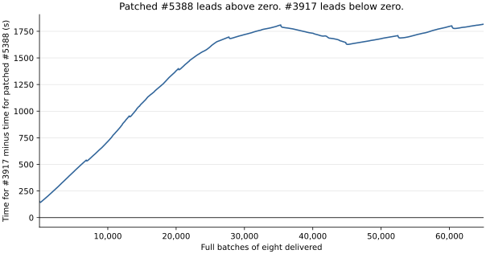

# Does indexed #3917 catch patched #5388 on MolmoAct2?

**Indexed #3917 never caught patched #5388 in any of the three paired runs.** In the longest run, patched #5388 delivered batch 65,000 in 37 min 50 s. #3917 took 68 min 7 s, including 10.71 s to receive and verify the matching index. The closest #3917 came in any run was 9.28 seconds behind at batch 29,951 in the first 8-vCPU pair. [Reader PR](https://github.com/lhoestq/lerobot/pull/1) · [Reproduction steps](method.md#run-patched-5388-and-indexed-3917-through-two-pool-refills)

## What happened past batch 30,000?

We started a fresh pair on another 8-vCPU host because the first pair finished only 9.49 s apart. Both 8-vCPU hosts reported the same AMD EPYC 7R13 model and quotas. Each reader reproduced its own first 30,000 batches. The repeat had a different timing curve from the start. Variations in host or remote service performance were not isolated.

| Fresh 8-vCPU repetition | Batch 1 | Batch 1,000 | Batch 30,000 | Batch 65,000 | Verified pool refills |
|---|---:|---:|---:|---:|---:|
| Patched #5388 | 14.29 s | 64.56 s | 15 min 18.09 s | 37 min 50.24 s | 8 |
| #3917 with matching index | 165.43 s | 255.36 s | 43 min 57.71 s | 68 min 7.08 s | 5 |

Each reader delivered 520,000 distinct usable examples, or 0.684% of a full pass. Patched #5388 averaged 7.05 distinct episodes per batch of eight, versus 5.60 for #3917. After batch 125, 49.6% of the two batch-mix distributions overlapped. Weighting both readers to that common mix gave mean waits of 32.68 ms for patched #5388 and 63.45 ms for #3917. [Episode diversity and wait-time audit](measurements/molmo-native-refills-diversity.json)

## What that implies for a full epoch

MolmoAct2 has 9,505,833 batches at size eight, including a final batch of two. Project the remaining examples at each reader’s measured delivery rate and add the time already spent. Changing the rate window changes the projected saving substantially.

| Rate used from the 65,000-batch repeat | Patched #5388 | #3917 with index | Projected saving with the patch |
|---|---:|---:|---:|
| Batches 126–65,000 | 3.79 days | 6.63 days | 2.84 days |
| Batches 30,001–65,000 only | 4.25 days | 4.57 days | 0.32 days |

In that last interval, #3917 delivered 193 examples/s and patched #5388 delivered 207 examples/s. The patched reader added 97 seconds to its lead over those 35,000 batches. The first 8-vCPU pair projected a slight epoch advantage for #3917, even though it finished behind. The two 30,000-batch pairs and the longer repeat support a faster start and an observed lead through the tested horizons. The projected saving over a full epoch varies by run and by rate window. [All 65,000 paired wall times](measurements/molmo-native-refills-65k03.curve.csv.gz) · [Refill checks, coverage, and rate windows](measurements/molmo-native-refills-65k03.json)

## The first two pairs reached 30,000 batches

Patched #5388 delivered every one of the first 30,000 batches sooner on both hosts. The lead at the last batch was 9.49 seconds on 8 vCPUs and 216.58 seconds on 16 vCPUs. Each reader delivered 240,000 distinct usable examples. Its ordered episode and frame IDs matched across hosts. Each reader used its own sampling order.

| Host | Reader | Batch 1 | Batch 1,000 | Batch 30,000 | Examples/s, batches 126–30,000 | Projected epoch |
|---|---|---:|---:|---:|---:|---:|
| 8 vCPU | #3917 with matching index | 144.49 s | 235.99 s | 40 min 35.87 s | 104.85 | 8.40 days |
| 8 vCPU | Patched #5388 | 20.28 s | 116.21 s | 40 min 26.39 s | 100.82 | 8.73 days |
| 16 vCPU | #3917 with matching index | 133.20 s | 203.31 s | 36 min 36.34 s | 116.38 | 7.56 days |
| 16 vCPU | Patched #5388 | 24.43 s | 122.46 s | 32 min 59.76 s | 124.62 | 7.06 days |

On 8 vCPUs, the patched reader's lead grew to 275 seconds at batch 13,175 and shrank to 9.49 seconds by batch 30,000. Its rate fell from 125 examples/s before the first refill (starting after batch 125) to 89 examples/s after the second. On 16 vCPUs, those rates were 130 and 122 examples/s. Each host ran one pair and the reader order was reversed, so host size and order changed together. [8-vCPU gap at every batch](measurements/molmo-native-refills-r01.svg) · [16-vCPU gap at every batch](measurements/molmo-native-refills-xl02.svg) · [Combined measurements](measurements/molmo-native-refills-both.json)

The pinned MolmoAct2 source contains 76,046,658 examples. With eight examples per batch, a full pass has 9,505,832 full batches and one final batch of two. Each 30,000-batch run covers 0.316% of the dataset. The epoch estimate adds time already measured to the time needed for the remaining examples at the observed rate after batch 125. It estimates CPU input delivery without model computation.

## What the comparison includes

The clocks start before dataset construction. For #3917 they also include downloading and validating a matching 1.83 GB publisher-built index. We supplied the index from a separate repository to simulate publication because the bucket's existing indexes have an older schema. The receipt took 10.30 s on 8 vCPUs and 9.41 s on 16 vCPUs.

Both readers used three current RGB camera views, current state, one current action, a pool of 32 episodes, batch size eight, seed 42 and zero DataLoader workers. A verified refill requires every anchor from the previous pool cohort and at least one anchor from each replacement span to reach the consumer. The first two verified refills were at batches 18,557 and 29,163 for #3917, and 6,878 and 13,175 for patched #5388. The former averaged 5.91 distinct episodes per batch over the full 30,000, the latter 7.06. They performed this comparison at their native levels of diversity. The source manifest matched before and after every run. [Reader patch](https://github.com/lhoestq/lerobot/pull/1) · [Run the experiment](method.md#run-patched-5388-and-indexed-3917-through-two-pool-refills)

All three new jobs finished. Together they added at most $1.349 to the HF Jobs total. The cumulative gross upper bound, including earlier experiments, is $11.02 against the $15 cap. [Cost ledger](measurements/compute-cost.json)
